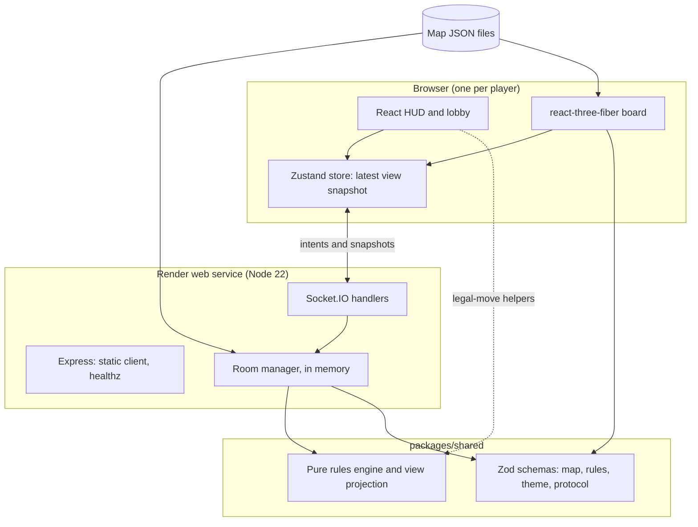
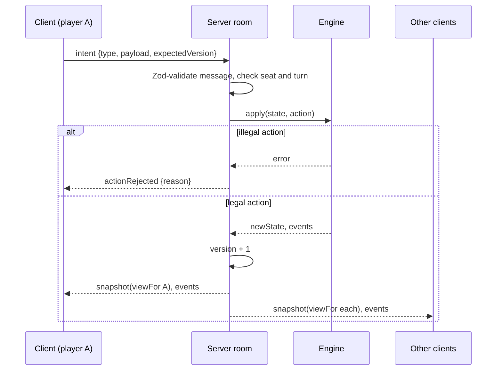
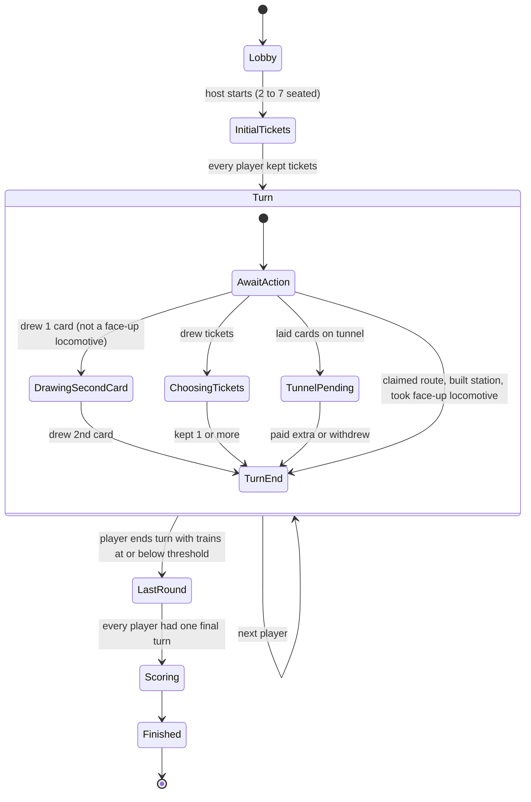
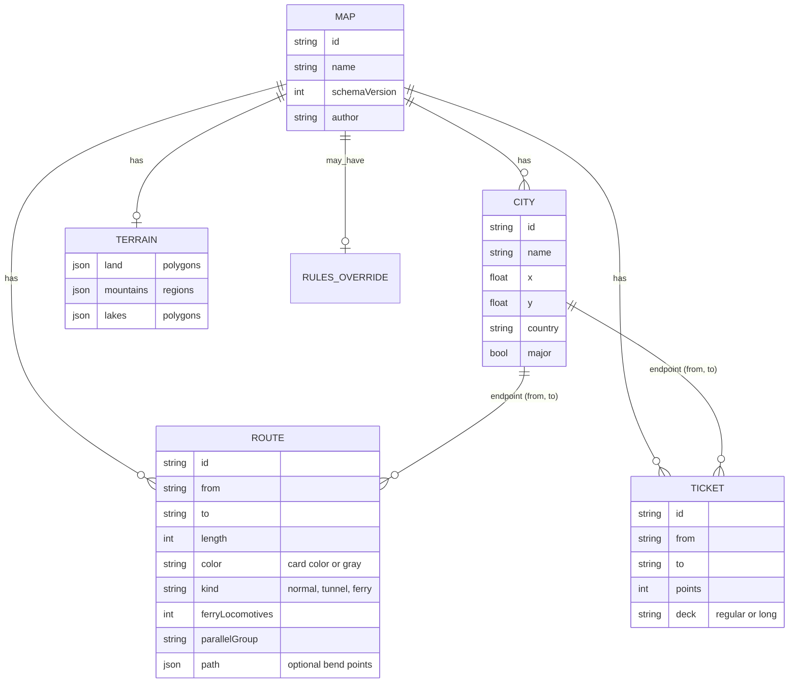
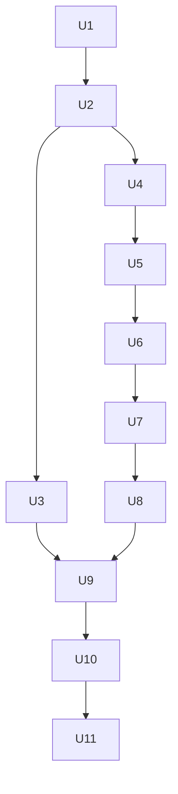

# Low-Poly Rails Online Game - Plan

Working title: ** Rails**. Rename freely.

---

## Goal Capsule

- **Objective:** A group of 2 to 7 friends opens one link, joins a room, and plays a complete Ticket to Ride–style game with the Europe expansion rules on a low-poly 3D North America board, hosted on Render.
- **Means:** A TypeScript monorepo with a pure shared rules engine, an authoritative Socket.IO server, a React + Three.js client, and data-driven map, rules, and theme files (KTD1, KTD2, KTD5).
- **Authority hierarchy:** Product Contract R-IDs win on behavior. KTDs win on mechanism. Unit approaches override neither. For rule details not written here, follow the official Ticket to Ride (USA) base rules, then the Ticket to Ride Europe rules for tunnels, ferries, stations, and long tickets.
- **Stop conditions:** Stop and ask when a rule interpretation would change gameplay beyond R6 to R13. Stop and ask when a unit seems to need map-specific code (this breaks R18). Stop and ask when Render cannot hold WebSocket connections for a full game.
- **Execution profile:** The rules engine is built test-first. The server is proven with socket integration tests. The client is proven by running the app with several browser windows.
- **Tail ownership:** The user owns the Render account, the GitHub repository, and the final deploy.

---

## Product Contract

### Summary

Build a browser game in the style of Ticket to Ride, the way Colonist is to Catan. Friends join a room by code, with no accounts, and play with 2 to 7 players. The game uses the base rules plus tunnels, ferries, stations, and long tickets, each switchable in the lobby. The board is a low-poly 3D North America map with the USA reference cities plus new cities in Canada, Mexico, and Cuba. Maps, rules, and visual themes are data files, so a future map editor only needs to produce a map file.

### Problem Frame

The user wants a private, customizable way to play a Ticket to Ride–style game online with friends. The commercial digital versions do not allow custom maps, more players, or house rules. The user has full control here, so the board can grow beyond the USA and the rules can mix the base game with expansion mechanics. The game is for fun among friends and will not be distributed publicly.

The user will edit this plan before implementation starts.

### Requirements

**Rooms and multiplayer**

- R1. The host creates a room and gets a short room code and a share link. Friends join with a nickname. There are no accounts.
- R2. A game seats 2 to 7 players by default. The limits come from the rules config, so raising them needs no code change.
- R3. The server validates every action. A client never receives hidden information: other hands, deck order, other players' tickets before the end, or the RNG seed.
- R4. A player who refreshes or loses connection rejoins the same seat while the room exists.
- R5. The host can start the game, toggle expansion rules, pick the map (starter map or an uploaded map file), remove a player in the lobby, and skip the turn of a disconnected player.

**Rules**

- R6. Base rules apply: 8 train-card colors plus locomotives; a 5-card face-up market that resets when 3 locomotives show; draw 2 cards per turn, where a face-up locomotive is the whole turn; claim a route with a matching card set; draw 3 tickets and keep at least 1; keep at least 2 of the initial tickets; the last round starts when a player ends a turn with 2 or fewer trains.
- R7. Parallel routes (double or triple lanes between the same cities) open lanes by player count, as set in the rules config. One player never claims two lanes of the same group.
- R8. Tunnels: after a player lays cards on a tunnel, the game reveals 3 cards from the draw deck. Each revealed card that matches the played color, and each revealed locomotive, costs 1 more card. The player pays the extra cards or withdraws and ends the turn.
- R9. Ferries: a ferry route needs at least its printed number of locomotives in the payment.
- R10. Stations: a player may build a station on any city without a station by paying 1, 2, then 3 cards of one color for the first, second, and third station. At the end, each station lets its owner use one route of another player that touches that city, only for tickets. Each unbuilt station scores points at the end.
- R11. Long tickets: at setup each player gets 1 long ticket and 3 regular tickets. Long tickets that are not dealt leave the game.
- R12. The host can switch each expansion rule (tunnels, ferries, stations, long tickets) on or off for a game. All are on by default. When a rule is off, its routes behave as normal routes.
- R13. The end screen shows each player's score breakdown: route points, completed and failed tickets, unbuilt-station points, and the longest-route bonus. Ties are broken by completed tickets, then by the longest route.

**Maps and customization**

- R14. A map is one versioned JSON document with cities, routes, tickets, terrain, and display hints. The game validates a map on load and reports readable errors.
- R15. The starter map "North America" contains the USA reference cities, the Canada list, the Mexico list, and La Habana (see the Appendix).
- R16. All game numbers live in a rules config: trains, stations, deck composition, scoring table, hand sizes, ticket deals, parallel-lane thresholds, player limits, and player colors. A map may override rules values.
- R17. A visual theme (card colors, player colors, terrain colors, lighting) is a data file. Players can switch themes on the client.
- R18. The engine and the renderer read all map facts from map data. No code depends on a specific map.

**Presentation**

- R19. The board is low-poly 3D with a tilted camera that pans and zooms. Claimed routes show train cars in the owner's color. Stations show on their cities.
- R20. The game targets desktop and laptop browsers. Phones are not a target.

**Hosting**

- R21. The game deploys to Render as one web service from the repository.

### Key Decisions

- **Expansion rules in v1, each switchable, all on by default.** (session-settled: user-directed — chosen over base-rules-only v1: the user wants expansions to "spice up the game" from the start.) Governs R8, R9, R10, R11, R12.
- **North America map, not USA only.** (session-settled: user-directed — chosen over the USA-only reference board: full control lets the map grow with Canada and Mexico.) Governs R15.
- **2 to 7 players, balance tuned after the MVP.** (session-settled: user-directed — chosen over 2 to 5 players: the friend group is larger; rebalancing is a later pass.) Governs R2, R7.
- **No persistence in v1.** (session-settled: user-approved — chosen over a database: games live in server memory; a restart or free-tier sleep ends active games.) Governs R4.
- **Visual map editor deferred; the map file is the seam.** (session-settled: user-approved — chosen over building the editor now: the format and the upload path come first.) Governs R14, R18.
- **Copy the reference board freely.** (session-settled: user-directed — chosen over an original layout: private use among friends.) Governs R15.

### Acceptance Examples

- AE1. Covers R7. Given a 3-player game and a parallel group with 2 lanes, when player A claims one lane, then nobody can claim the other lane.
- AE2. Covers R7. Given a 5-player game and the same group, when player A claims one lane, then player B can claim the other lane and player A cannot.
- AE3. Covers R8. Given a player pays 3 red cards for a gray tunnel of length 3, when the reveal shows red, locomotive, blue, then the player must add 2 cards (red or locomotive) or withdraw. On withdraw, the 3 red cards return to the hand and the turn ends.
- AE4. Covers R8. Given a player pays only locomotives for a tunnel, when the reveal shows 1 locomotive and 2 colors, then the extra cost is 1 locomotive.
- AE5. Covers R10. Given player A has a station in Denver and player B owns Denver–Omaha, when the game ends, then player A may count Denver–Omaha for tickets only, not for the longest route.
- AE6. Covers R12. Given the host switches ferries off, when a player claims a ferry route, then any matching card set works and no locomotive minimum applies.
- AE7. Covers R4. Given player C closes the tab during their turn, when C opens the same link within the room lifetime, then C sees their own hand and the turn continues.

### Scope Boundaries

- No accounts, rankings, or matchmaking with strangers.
- No bots or AI players.
- No mobile layout.
- No in-game voice or chat. The group uses Discord or similar.
- No spectators. A game in progress rejects new joins.

#### Deferred to Follow-Up Work

- Visual map editor. Planned shape: a client route that reuses the board renderer and the map validator to place cities, draw routes, and export the map file (see KTD5, KTD6).
- Game persistence (snapshot rooms to Render Key Value or Postgres) so restarts do not end games.
- Balance pass for 7 players and the bigger map: deck size, trains per player, ticket points, lane thresholds.
- More expansion ideas: big-city bonuses, mega tickets, events.
- Spanish UI. Strings live in one module so translation is easy later.
- Turn timer and undo.

### Outstanding Questions

All questions below are deferred. None blocks implementation.

- Final game name and logo.
- Exact route colors and ticket points on the starter map. U3 sets first values with the validator's stats and the ticket-points helper. Playtests tune them.
- Deck size with 7 players. The default is the standard 110 cards. The rules config can raise it.
- Churchill links to Winnipeg and Regina in the draft. Edmonton is the alternative.

---

## Planning Contract

### Key Technical Decisions

- KTD1. **TypeScript monorepo with npm workspaces, Node + Socket.IO server, Three.js board.** (session-settled: user-approved — chosen over the Colyseus game-server framework: fewer abstractions and no framework lock-in for a small friend-group game.) Packages: `packages/shared` (schemas, rules engine, protocol), `apps/server`, `apps/client`. npm workspaces avoid extra tooling on Windows. *Use typescript for more freedom*
- KTD2. **The rules engine is a pure, deterministic reducer.** It takes state and an action and returns a new state plus a list of events. The RNG is seeded, and its state lives inside the game state. Only the server calls it to change state. The client imports it only for read-only helpers, such as legal payment options. This makes rules testable without a network and makes replays possible. *Approved*
- KTD3. **After each action, the server sends each player a full view snapshot plus the action's events.** `viewFor(state, playerId)` removes hidden information (R3). Snapshots carry a version number. A game state is a few tens of KB, so full snapshots are cheap and avoid diff bugs. Events drive animations only. They never change client state. *Approved*
- KTD4. **Client uses React, react-three-fiber, drei, and Zustand.** React fits the HUD, lobby, and dialogs. react-three-fiber keeps the 3D scene declarative and fits the future editor (drag handles, forms). Zustand holds the latest snapshot and UI state. *Approved*
- KTD5. **Zod schemas are the single source for map, rules, theme, and protocol validation.** The same schemas run on server and client. A script exports JSON Schema from them so a future editor or a text editor can validate map files. *Approved*
- KTD6. **Maps use abstract map-space coordinates.** Cities have `x, y` in a 0 to 1000 wide space, plus optional `geo` (lat/lon) for reference. The starter map is generated from real lat/lon by a projection script (d3-geo, conic conformal) at authoring time. Terrain land and lake polygons come from Natural Earth 1:50m (public domain). Polygons that overlap the map area are kept whole (not clipped), simplified, and stored in the map file. Cities may carry a `nudge` in the sources to give short routes room. *Approved*
- KTD7. **Parallel routes share a `parallelGroup` id.** A group can hold 2 or more lanes. The rules config maps player count to open lanes (default: 1 lane for 2 to 3 players, all lanes for 4 or more). This supports triple lanes for 7 players without code changes (R7). *I wanted to be phisically visible, as in a board game* 
- KTD8. **The player chooses the borrowed route when building the station.** The route must touch the station's city and must not be the builder's own. At scoring, union-find connects the player's own routes plus each station's chosen route when another player owns it then. No assignment search is needed. *Let them make the chocie when it's build*
- KTD9. **Longest route is a depth-first search for the longest trail** over each player's own routes. Edges are used once, and cities may repeat. Station-borrowed routes do not count. The graph per player is small, so brute force is enough. *Sure*
- KTD10. **Seat identity uses a random reconnect token** kept in the browser's localStorage per room. Room codes are 5 characters from an alphabet without look-alike characters (no 0/O, 1/I/L). When the same token connects twice, the newest socket wins. *Approved*
- KTD11. **One Render web service.** Express serves the built client and `/healthz`. Socket.IO shares the same port (`PORT` env). A `render.yaml` blueprint defines build and start commands. The Node version is pinned to 22 LTS. *sure*
- KTD12. **Low-poly rendering.** Flat-shaded materials with vertex colors. Terrain is a triangular lattice over the map; each facet is classified as land, lake, or water by a scanline point-in-polygon test, with small height jitter per vertex, over a water plane. (Triangulating the projected coastlines broke on the huge Americas polygon.) City labels are one DOM layer positioned each frame. Mountains are scattered low-poly cones in tunnel regions. Route slots and train cars use instanced meshes. The camera uses a tilt with rotation off and clamped pan and zoom. Device pixel ratio is capped at 2. *Works for me*
- KTD13. **Room cleanup.** An empty room is deleted after 10 minutes. A finished game's room is deleted after 30 minutes. Memory stays bounded on a small Render instance. *Sure*
- KTD14. **A map file can override rules values, and lobby toggles apply last.** Order: rules defaults, then map overrides, then lobby toggles. The resolved rules are frozen into the game state at start. *Sure*

### High-Level Technical Design

**Components**



**One player action**



**Game phases and turn states**



**Map data model (the editor seam)**



### Output Structure

```text
package.json                      workspaces, root scripts
tsconfig.base.json
vitest.workspace.ts
render.yaml
packages/shared/
  src/map/          schema, validate, graph helpers, ticket-points helper
  src/rules/        rules schema, defaults, resolution
  src/theme/        theme schema
  src/engine/       state, rng, setup, cards, routes, payments, tickets,
                    tunnels, stations, scoring, longest, reducer, view
  src/protocol/     client and server message schemas
  test/
apps/server/
  src/              index, http, rooms, net
  test/
apps/client/
  src/net/  src/state/  src/ui/lobby/  src/ui/hud/  src/board/  src/theme/
  e2e/
maps/
  north-america.map.json          generated starter map (the editable artifact)
  sources/north-america/          lat/lon cities, routes, tickets for the build script
tools/
  map-build/                      projection and terrain baking script
  map-schema/                     JSON Schema export
```

The per-unit **Files** lists below are authoritative. This tree only shows the shape.

### Implementation Constraints

- No map-specific identifiers (city ids, route ids) in engine, server, or client code. Tests may use small fixture maps.
- No `Math.random` in the engine. All randomness goes through the seeded RNG in state.
- Server messages are Zod-validated before any handler logic runs.
- UI strings live in one module (`apps/client/src/ui/strings.ts`) for later translation.

### System-Wide Impact

- **Hidden information:** `viewFor` is the only path from state to the network. Every new state field must be classified as public, owner-only, or server-only in that module.
- **Shared package:** Both server and client import `packages/shared`. Schema changes affect map files, protocol, and saved themes together. Bump `schemaVersion` on breaking map changes.
- **Hosting limits:** A Render free instance sleeps after about 15 minutes without traffic and restarts on deploy. Both end every live game. A paid starter instance avoids sleep but not deploy restarts.

### Risks & Dependencies

| Risk | Mitigation |
|---|---|
| Expansion rules interact in tricky ways (tunnel reveal with empty deck, station borrowing with parallel lanes). | Engine is test-first (U4 to U6). Edge cases are listed per unit. |
| Hidden information leaks through a snapshot. | Dedicated `viewFor` tests assert no foreign hands, deck order, seed, or unrevealed tickets in any view. |
| Free-tier sleep or a redeploy kills a game in progress. | Documented in the README. Do not deploy during game night. Persistence is deferred follow-up work. |
| 55 cities and 7 players make the board crowded. | Zoom levels with label fading, route hover highlight, and city search in the HUD. |
| Low-end laptops struggle with 3D. | Low-poly geometry, instancing, pixel ratio cap, no real-time shadows by default. |
| Coastline processing takes longer than planned. | Fallback: hand-drawn simplified land polygons in the map sources. |

**Prerequisites:** Node 22 LTS, a git repository pushed to GitHub (the folder is not a git repo yet), and a Render account.

### Sequencing



Phases: Foundations (U1 to U3), Rules engine (U4 to U6), Multiplayer server (U7), Client (U8 to U10), Ship (U11). U3 (map data) can run alongside U4 to U6.

---

## Implementation Units

| U-ID | Title | Key files | Depends on |
|---|---|---|---|
| U1 | Workspace scaffold | `package.json`, `tsconfig.base.json`, `vitest.workspace.ts` | none |
| U2 | Map, rules, and theme schemas with validator | `packages/shared/src/map/*`, `packages/shared/src/rules/*` | U1 |
| U3 | North America starter map | `maps/north-america.map.json`, `tools/map-build/*` | U2 |
| U4 | Core rules engine | `packages/shared/src/engine/*` | U2 |
| U5 | Expansion rules | `packages/shared/src/engine/tunnels.ts`, `stations.ts`, `payments.ts` | U4 |
| U6 | Scoring | `packages/shared/src/engine/scoring.ts`, `longest.ts` | U5 |
| U7 | Multiplayer server | `apps/server/src/*` | U6 |
| U8 | Client shell, lobby, themes | `apps/client/src/net/*`, `src/state/*`, `src/ui/lobby/*`, `src/theme/*` | U7 |
| U9 | Low-poly 3D board | `apps/client/src/board/*` | U3, U8 |
| U10 | Game HUD and interactions | `apps/client/src/ui/hud/*` | U9 |
| U11 | Render deployment and smoke test | `render.yaml`, `apps/client/e2e/*` | U10 |

### U1. Workspace scaffold

**Goal:** A working TypeScript monorepo with build, test, lint, and dev scripts.

**Requirements:** R21 (build shape), KTD1.

**Dependencies:** none.

**Files:**
- `package.json`, `tsconfig.base.json`, `vitest.workspace.ts`, `.gitignore`, `.editorconfig`, `.nvmrc`
- `packages/shared/package.json`, `packages/shared/tsconfig.json`
- `apps/server/package.json`, `apps/server/tsconfig.json`
- `apps/client/package.json`, `apps/client/tsconfig.json`, `apps/client/vite.config.ts`, `apps/client/index.html`
- `README.md`

**Approach:**
1. Initialize git (the folder is not a repository yet) and npm workspaces.
2. Root scripts: `dev` (server and client watch at the same time, Vite proxies Socket.IO to the server), `build`, `test`, `typecheck`, `lint`, `validate:maps`.
3. ESLint and Prettier with one shared config.

**Test expectation:** none -- scaffolding only. Verified by running the scripts.

**Verification:** `npm run dev` serves a blank client page that connects to the server socket. `npm test` runs with zero tests and passes.

### U2. Map, rules, and theme schemas with validator

**Goal:** Zod schemas and a validator that define what a map, a rules config, and a theme are.

**Requirements:** R14, R16, R17, R18, KTD5, KTD6, KTD7, KTD14.

**Dependencies:** U1.

**Files:**
- `packages/shared/src/map/schema.ts`, `packages/shared/src/map/validate.ts`, `packages/shared/src/map/graph.ts`, `packages/shared/src/map/ticketPoints.ts`
- `packages/shared/src/rules/schema.ts`, `packages/shared/src/rules/defaults.ts`, `packages/shared/src/rules/resolve.ts`
- `packages/shared/src/theme/schema.ts`
- `tools/map-schema/export.ts`
- `packages/shared/test/map-validate.test.ts`, `packages/shared/test/rules-resolve.test.ts`, `packages/shared/test/fixtures/tiny.map.json`

**Approach:**
- The map schema follows the data model in the High-Level Technical Design.
- The validator runs after the schema check and reports every problem with the path to the bad item. It checks:
  - unique ids
  - route and ticket endpoints exist
  - no route from a city to itself
  - lengths within the scoring table
  - ferry locomotives at or below the route length
  - lanes in a parallel group share the same endpoints and length
  - the whole graph is connected
  - each ticket's endpoints are reachable
  - enough long tickets for the maximum player count
- `validate` also returns stats: route count per color, total trains on the board, and ticket point spread. U3 uses them to balance colors.
- `ticketPoints.ts` suggests ticket points from the shortest path length in trains. Authors use it as a starting value.
- Default rules use the standard values: 45 trains, 3 stations worth 4 points each, a 110-card deck (12 of each of the 8 colors plus 14 locomotives), 4 starting cards, and 5 face-up cards. The route scoring table is 1:1, 2:2, 3:4, 4:7, 5:10, 6:15, 7:18, 8:21. Longest-route bonus is 10. The end trigger is 2 trains. Player limits are 2 to 7. There are 7 player colors. The lane table follows KTD7.
- `resolve.ts` merges rules in the order set by KTD14 and freezes the result.

**Test scenarios:**
- Happy path: the tiny fixture map validates with no errors and correct stats.
- Error path: a route pointing to a missing city yields one error naming the route id and the missing city id.
- Error path: a ferry with 3 locomotives on a length-2 route is rejected.
- Error path: parallel lanes with different lengths are rejected.
- Error path: a map with two disconnected islands reports the unreachable cities.
- Error path: a map with 5 long tickets fails when max players is 7 and long tickets are enabled.
- Edge case: a route of length 9 fails when the scoring table stops at 8.
- Happy path: `ticketPoints` on the fixture returns the shortest path length in trains.
- Happy path: rules resolution applies a map override (trains = 40) and then a lobby toggle (stations off) in the right order.
- Error path: a rules config with min players above max players is rejected.

**Verification:** The validator rejects each broken fixture with a readable message. JSON Schema export produces a file that VS Code can use to validate a map.

### U3. North America starter map

**Goal:** A valid, playable North America map file built from real geography.

**Requirements:** R15, R14, KTD6.

**Dependencies:** U2.

**Files:**
- `maps/sources/north-america/cities.json` (id, name, lat, lon, country, major)
- `maps/sources/north-america/routes.json`, `maps/sources/north-america/tickets.json`
- `maps/sources/north-america/land.geojson` (Natural Earth 1:50m land, clipped)
- `tools/map-build/build.ts`
- `maps/north-america.map.json` (generated, committed)
- `packages/shared/test/starter-map.test.ts`

**Approach:**
1. List the cities and routes from the Appendix tables. Copy USA routes, colors, and lengths from the reference board (`References/1.webp`).
2. The build script projects lat/lon to map-space with a conic conformal projection over the map area (roughly lon −136 to −58, lat 17 to 61). It simplifies and bakes land polygons, then writes the map file.
3. Mark mountain crossings as tunnels and water crossings as ferries, as the Appendix proposes.
4. Assign colors to new routes so the validator's color stats stay roughly even.
5. Use the ticket-points helper for first ticket values. Write about 46 regular tickets (the 30 USA tickets plus about 16 cross-border tickets) and 9 long tickets.
6. Once the visual editor exists, it edits the generated file directly. The sources are only for building the starter map.

**Test scenarios:**
- Happy path: the generated map passes the validator with zero errors.
- Happy path: the map holds every city named in R15 (assert the Canada, Mexico, and La Habana ids exist).
- Edge case: at least 9 long tickets exist, enough for 7 players.
- Happy path: every route marked ferry has a locomotive count of 1 or more.

**Verification:** `npm run validate:maps` passes. The color distribution printout shows no color with more than about 1.5 times the trains of the rarest color.

### U4. Core rules engine

**Goal:** A pure engine that plays a full base-rules game.

**Requirements:** R2, R3, R6, R7, KTD2, KTD3, KTD7, KTD14.

**Dependencies:** U2.

**Files:**
- `packages/shared/src/engine/state.ts`, `rng.ts`, `setup.ts`, `cards.ts`, `routes.ts`, `payments.ts`, `tickets.ts`, `reducer.ts`, `view.ts`, `actions.ts`
- `packages/shared/test/engine/setup.test.ts`, `cards.test.ts`, `routes.test.ts`, `tickets.test.ts`, `turns.test.ts`, `view.test.ts`, `fullgame.test.ts`

**Approach:**
- The state holds the resolved rules, the map id, players (seat, color, hand, trains, stations, tickets, pending choices), the draw pile, the discard pile, the face-up market, the ticket decks, route ownership, the phase, the turn sub-state, and the RNG state.
- Actions: `keepInitialTickets`, `drawFaceUp`, `drawBlind`, `claimRoute`, `drawTickets`, `keepTickets`, `pass`. `buildStation` and `resolveTunnel` come in U5.
- `payments.ts` computes legal card sets for a route and a hand. The client uses it to offer choices.
- `pass` is legal only when no other action is legal (empty decks, no affordable route).
- `view.ts` follows KTD3. It classifies each field as public, owner-only, or server-only.

**Execution note:** Implement test-first. The full-game test plays a scripted game on the fixture map from setup to the Finished phase.

**Test scenarios:**
- Happy path: setup with 4 players deals 4 cards and 3 tickets each, shows 5 face-up cards, and gives each player 45 trains.
- Happy path: drawing a blind card then a face-up color card ends the turn.
- Edge case: taking a face-up locomotive as the first draw ends the turn. Taking it as the second draw is rejected.
- Edge case: when 3 locomotives show after a refill, the market is discarded and redealt.
- Edge case: when deck and discard together hold fewer than 5 cards, the market shows what remains and the loop stops.
- Edge case: the draw pile empties mid-turn, the discard is reshuffled in, and drawing continues.
- Happy path: claiming a red length-4 route with 3 red and 1 locomotive works. Trains drop by 4 and route points add 7.
- Error path: claiming with mixed colors on a gray route is rejected.
- Error path: claiming with fewer trains left than the route length is rejected.
- Covers AE1. Lanes stay closed in a 3-player game.
- Covers AE2. Lanes open in a 5-player game, and the same player cannot take both lanes.
- Happy path: with triple lanes, 7 players, and the lane table set to 3 lanes at 6 or more players, three different players claim the three lanes.
- Happy path: drawing tickets offers 3. Keeping 0 is rejected. Keeping 1 ends the turn and returns the others to the bottom of the deck.
- Edge case: with 2 tickets left in the deck, drawing tickets offers 2.
- Happy path: a player ends the turn with 2 trains, the last round starts, and every player including that player gets exactly one more turn.
- Error path: an action from a player whose turn it is not is rejected without changing state.
- Integration: `viewFor` player B in a 4-player game contains B's hand and tickets, the other players' hand counts only, no deck order, and no RNG state.
- Happy path: the same seed and the same action list produce identical final states.

**Verification:** The scripted full game reaches Finished. All engine tests pass with no network or DOM.

### U5. Expansion rules

**Goal:** Tunnels, ferries, stations, and long tickets, each obeying its lobby toggle.

**Requirements:** R8, R9, R10, R11, R12, KTD2, KTD14.

**Dependencies:** U4.

**Files:**
- `packages/shared/src/engine/tunnels.ts`, `packages/shared/src/engine/stations.ts`
- Modify: `packages/shared/src/engine/payments.ts`, `setup.ts`, `reducer.ts`, `actions.ts`, `view.ts`
- `packages/shared/test/engine/tunnels.test.ts`, `ferries.test.ts`, `stations.test.ts`, `long-tickets.test.ts`, `toggles.test.ts`

**Approach:**
- Tunnel claim moves the turn to `TunnelPending`. The payment is held aside. The engine reveals up to 3 cards. When the deck runs short, the discard is reshuffled first. The reveal is public. `resolveTunnel` takes either extra cards or `withdraw`. Revealed cards go to the discard either way.
- When the player cannot afford the extra cost, only `withdraw` is legal.
- Ferry payments need the ferry's locomotive count. The other cards must be one color, or locomotives.
- `buildStation` costs 1, 2, then 3 cards of one color. Locomotives may substitute. At most one station per city across all players.
- Long tickets: setup deals 1 long and 3 regular tickets. The player keeps at least 2 of the 4. Undealt long tickets leave the game.
- Toggles: when a rule is off, tunnels are claimed as normal routes, ferries need no locomotives, `buildStation` is illegal and unbuilt stations score nothing, and setup deals 3 regular tickets only.

**Execution note:** Test-first, one rule at a time, each with its toggle.

**Test scenarios:**
- Covers AE3. Gray tunnel with 3 red played, reveal red/locomotive/blue: extra cost is 2. Withdraw returns the 3 red cards and ends the turn.
- Covers AE4. A locomotive-only payment counts only revealed locomotives.
- Edge case: tunnel reveal with only 1 card left in deck and discard reveals 1 card.
- Edge case: a player cannot afford the extra cost, so only withdraw is offered and accepted.
- Happy path: a ferry of length 4 needing 1 locomotive accepts 1 locomotive and 3 green cards.
- Error path: the same ferry rejects 4 green cards.
- Happy path: the second station costs 2 cards of one color. Trains are unchanged and station count drops.
- Error path: a station on a city that already has any station is rejected.
- Error path: a fourth station is rejected.
- Happy path: with long tickets on, setup offers 4 tickets (1 long). Keeping only 1 is rejected.
- Covers AE6. With ferries off, a ferry is claimable with no locomotive.
- Happy path: with stations off, `buildStation` is rejected and the HUD view reports stations as unavailable.
- Integration: during `TunnelPending`, `viewFor` shows the reveal and the pending payment to all players and keeps the hand private.

**Verification:** All expansion tests pass. The full-game test from U4 also passes with all rules on, after scripting at least one tunnel, ferry, and station.

### U6. Scoring

**Goal:** Exact end-game scoring with a breakdown.

**Requirements:** R10, R11, R13, KTD8, KTD9.

**Dependencies:** U5.

**Files:**
- `packages/shared/src/engine/scoring.ts`, `packages/shared/src/engine/longest.ts`
- `packages/shared/test/engine/scoring.test.ts`, `longest.test.ts`

**Approach:**
- Scoring returns per player:
  - route points (kept during play)
  - completed tickets
  - failed tickets
  - station assignments chosen
  - unbuilt stations
  - longest trail length
  - bonus
  - total
- Station borrowing follows KTD8 (the route chosen at build time). Longest route follows KTD9. All players tied on the longest trail get the bonus.
- Tie-break follows R13.

**Test scenarios:**
- Happy path: a completed ticket adds its points. A failed ticket subtracts its points.
- Covers AE5. A Denver station borrowing Denver–Omaha completes a ticket. The borrowed route does not extend the longest trail.
- Edge case: two stations that could borrow different routes are assigned to maximize total ticket points, not the count of completed tickets.
- Edge case: a station whose city has no opponent routes contributes nothing and does not crash.
- Happy path: a trail with a loop (A–B–C–A–D) counts every route once and returns the full length.
- Edge case: two players tied for longest trail both get 10 points.
- Happy path: unbuilt stations score 4 each with stations on and 0 with stations off.
- Happy path: tie on total resolves by completed tickets, then by longest trail.

**Verification:** Scoring tests pass. The full-game test prints a breakdown whose totals match the expected values written in the test.

### U7. Multiplayer server

**Goal:** Rooms, lobby, authoritative play, and reconnection over Socket.IO.

**Requirements:** R1, R2, R3, R4, R5, R12, R14, KTD3, KTD10, KTD11, KTD13.

**Dependencies:** U6.

**Files:**
- `apps/server/src/index.ts`, `apps/server/src/http.ts`
- `apps/server/src/rooms/RoomManager.ts`, `apps/server/src/rooms/Room.ts`, `apps/server/src/rooms/codes.ts`
- `apps/server/src/net/handlers.ts`
- `packages/shared/src/protocol/messages.ts`
- `apps/server/test/rooms.test.ts`, `apps/server/test/socket.integration.test.ts`

**Approach:**
- Lobby state: seats with nickname, color, connected flag, and host flag. It also holds the chosen map, the rule toggles, and the resolved-rules preview.
- Join rules:
  - Duplicate nicknames get a numeric suffix.
  - A full room rejects joins.
  - A started game rejects new joins.
  - When the host leaves the lobby, host passes to the next seat.
- Custom map upload: the host sends map JSON, capped at 2 MB. The server validates it with U2 and broadcasts it to the room. The map is used only for that room.
- Every intent carries `expectedVersion`. A stale intent is rejected so the client resyncs.
- Host skip: during a turn, skip passes the turn. During initial ticket selection, the skipped player keeps all offered tickets.
- Rooms are cleaned up per KTD13.
- A basic per-socket message rate limit drops floods.

**Execution note:** Start with a failing socket integration test for create, join, start, and one action.

**Test scenarios:**
- Happy path: host creates a room and gets a 5-character code. Two guests join and see three seats.
- Error path: an eighth player joining a full 7-seat room is rejected with a clear reason.
- Error path: joining a room code that does not exist is rejected.
- Error path: a non-host trying to start the game is rejected.
- Error path: start with 1 player is rejected.
- Covers AE7. A player disconnects and reconnects with the same token, gets the same seat, and receives a fresh snapshot.
- Edge case: the same token connects from a second tab, the first socket is dropped, and the second socket is live.
- Error path: an intent with a stale `expectedVersion` is rejected and the sender receives the current snapshot.
- Error path: a malformed message fails Zod validation and the server does not crash.
- Integration: after one player draws a card, every client receives a snapshot. No snapshot contains another player's hand.
- Happy path: a valid uploaded map replaces the starter map in the lobby for all clients.
- Error path: an invalid uploaded map returns the validator errors to the host only.
- Edge case: an empty room disappears after the cleanup timeout (fake timers).
- Happy path: the host skips a disconnected player's turn and the next player is active.

**Verification:** Integration tests run a 3-client game to Finished with scripted actions over real sockets.

### U8. Client shell, lobby, and themes

**Goal:** Players can create or join a room, set up the game, and pick a theme.

**Requirements:** R1, R5, R12, R14, R17, R20, KTD4, KTD10.

**Dependencies:** U7.

**Files:**
- `apps/client/src/main.tsx`, `apps/client/src/App.tsx`
- `apps/client/src/net/socket.ts`, `apps/client/src/state/store.ts`
- `apps/client/src/ui/lobby/Home.tsx`, `Lobby.tsx`, `RulesPanel.tsx`, `MapPicker.tsx`
- `apps/client/src/ui/strings.ts`
- `apps/client/src/theme/themes/classic.json`, `apps/client/src/theme/themes/night.json`, `apps/client/src/theme/ThemeProvider.tsx`
- `apps/client/src/state/store.test.ts`

**Approach:**
- The URL `/r/<code>` opens the join screen for that room. The reconnect token lives in localStorage per KTD10.
- The store keeps the last snapshot, ignores snapshots with an older version, and exposes a connection status.
- The lobby shows seats and player colors. The host sees the rule toggles, the map picker (starter map or file upload), the start button, and remove buttons.
- Two themes ship: a daytime one and a night one. The theme choice is saved in localStorage.

**Test scenarios:**
- Happy path: the store replaces the state on a newer snapshot version.
- Edge case: the store ignores an older snapshot that arrives late.
- Happy path: a theme file that fails the theme schema falls back to the default theme with a console warning.
- Integration: opening `/r/ABCDE` with a stored token for that room sends a reconnect, not a new join.

**Verification:** In three browser windows, the host creates a room, two players join by link, the host toggles rules, and all windows show the same lobby.

### U9. Low-poly 3D board

**Goal:** Render any valid map as a low-poly 3D board with claimed routes and stations.

**Requirements:** R18, R19, R20, KTD4, KTD6, KTD12.

**Dependencies:** U3, U8.

**Files:**
- `apps/client/src/board/BoardScene.tsx`, `Terrain.tsx`, `Cities.tsx`, `Routes.tsx`, `Trains.tsx`, `Stations.tsx`, `CameraRig.tsx`, `Labels.tsx`
- `apps/client/src/board/geometry.ts` (route path to slot transforms, parallel lane offsets)
- `apps/client/src/board/geometry.test.ts`

**Approach:**
- `geometry.ts` turns a route into an ordered list of slot positions and rotations. It uses optional bend points and offsets parallel lanes sideways. It is pure and testable.
- Routes:
  - Route slots are an instanced mesh tinted by route color.
  - Tunnels get dark slot borders and portal markers at both ends.
  - Ferries get a wave mark on each locomotive slot.
- Claimed slots are covered by low-poly train-car instances in the owner's player color.
- City labels fade by zoom level. Major cities stay visible.
- Hover and click on a route call the HUD (U10) through the store. Hover highlights the whole route.
- The board is built only from map data and theme data (R18). It must render the tiny fixture map as well as the starter map.

**Test scenarios:**
- Happy path: a length-4 straight route yields 4 evenly spaced slots between its city edges.
- Happy path: a route with one bend point yields slots that follow both segments and keep total length.
- Edge case: two lanes of a parallel group get mirrored offsets that do not overlap.
- Edge case: three lanes produce a center lane plus two offset lanes.

**Verification:** The starter map renders on a laptop at a smooth frame rate. The fixture map also renders. Claiming a route in a dev game shows train cars in the right color.

### U10. Game HUD and interactions

**Goal:** Players can play every action from the UI and read the game state at a glance.

**Requirements:** R6, R8, R9, R10, R11, R13, R19, R20.

**Dependencies:** U9.

**Files:**
- `apps/client/src/ui/hud/Hand.tsx`, `Market.tsx`, `Tickets.tsx`, `TicketChoice.tsx`, `ClaimDialog.tsx`, `TunnelPrompt.tsx`, `StationMode.tsx`, `Scoreboard.tsx`, `EventLog.tsx`, `EndScreen.tsx`, `TurnBanner.tsx`
- `apps/client/src/ui/hud/claimOptions.test.ts`

**Approach:**
- `ClaimDialog` lists the legal payment options from the shared `payments.ts` helper. When only one option exists, it preselects it.
- `TunnelPrompt` shows the 3 revealed cards to everyone. The active player sees "pay extra" options or "withdraw".
- Station mode highlights eligible cities and shows the next station cost.
- Ticket progress highlights the ticket's cities on the board. It shows whether the player's own routes connect them so far. Station borrowing is not shown before the end.
- The scoreboard shows each player's color, score, trains, stations, card count, and ticket count. A disconnected player is marked, and the host sees a skip button.
- The end screen shows the R13 breakdown and highlights each player's longest trail on the board.
- The event log shows recent actions in plain language.

**Test scenarios:**
- Happy path: for a hand of 3 blue, 2 locomotives and a gray length-3 route, the options include blue×3, blue×2+loco, blue×1+loco×2, and loco×2 is not offered because it is too short.
- Edge case: for a ferry needing 1 locomotive and a hand without locomotives, the claim button is disabled with a reason.
- Edge case: an empty hand disables the claim button on every route.

**Verification:** A manual 3-player game in three windows covers card draws, a normal claim, a tunnel (pay and withdraw), a ferry, a station, ticket draws, the last round, and the end screen.

### U11. Render deployment and smoke test

**Goal:** One-click deploy to Render and an automated smoke test of the full path.

**Requirements:** R21, KTD11.

**Dependencies:** U10.

**Files:**
- `render.yaml`
- Modify: `apps/server/src/http.ts` (serve built client, SPA fallback, `/healthz`)
- `apps/client/e2e/smoke.spec.ts`, `playwright.config.ts`
- Modify: `README.md` (deploy steps, free-tier caveats)

**Approach:**
- The build command installs dependencies and builds shared, client, and server. The start command runs the server.
- The health check path is `/healthz`. The Node version is pinned through `.nvmrc` and the `engines` field.
- The README explains:
  - Connect the GitHub repository in Render as a Blueprint.
  - Open the URL once before game night to wake the free instance.
  - Do not deploy during a game.
- The Playwright smoke test starts the production build locally. It opens two browser contexts, creates and joins a room, starts the game, and checks that both see the board and the hand.

**Execution note:** This unit is mostly packaging. Prefer runtime smoke checks over unit tests.

**Test scenarios:**
- Integration: the smoke test reaches the first turn with two players on the production build.
- Happy path: `/healthz` returns 200 on the production build.

**Verification:** The service deploys on Render from the blueprint. Three friends on different networks complete a game through the public URL.

---

## Verification Contract

| Gate | Command | When |
|---|---|---|
| Types | `npm run typecheck` | Every unit |
| Lint | `npm run lint` | Every unit |
| Unit and integration tests | `npm test` (Vitest across workspaces) | Every feature unit |
| Map validation | `npm run validate:maps` | U2, U3, and any map change |
| Production build | `npm run build` | U8 onward |
| End-to-end smoke | `npm run test:e2e` (Playwright) | U11, then before each deploy |
| Manual playtest | 3 browser windows, full game with all rules on | U10, U11 |

---

## Definition of Done

**Global**

- Every requirement R1 to R21 is met or listed as deferred with a reason.
- All gates in the Verification Contract pass.
- No map-specific identifiers exist outside `maps/` and test fixtures.
- No hidden information appears in any client snapshot (U4 and U7 tests).
- Dead code from abandoned attempts is removed.
- The README explains local dev, map files, rules config, themes, and Render deploy.
- One real game with at least 3 friends finished on the Render URL.

**Per unit**

| Unit | Done when |
|---|---|
| U1 | Dev, build, and test scripts run on Windows. |
| U2 | Every broken fixture produces a readable error. JSON Schema is exported. |
| U3 | The starter map validates and holds every city in the Appendix. |
| U4 | The scripted base-rules game reaches Finished, and the view projection tests pass. |
| U5 | Each expansion rule and its toggle are proven by tests. |
| U6 | Scoring matches hand-computed totals, including station borrowing and longest-trail ties. |
| U7 | A 3-client socket game finishes. Reconnect and stale-version cases pass. |
| U8 | Three windows share one lobby. Themes switch. |
| U9 | Starter and fixture maps render. Claimed routes show train cars. |
| U10 | Every action is playable from the UI in a manual game. |
| U11 | Render deploy works, and the e2e smoke test passes. |

---

## Appendix

### A. Starter map cities

**USA (from the reference board):** Vancouver, Seattle, Portland, San Francisco, Los Angeles, Las Vegas, Phoenix, El Paso, Santa Fe, Salt Lake City, Helena, Denver, Omaha, Duluth, Kansas City, Oklahoma City, Dallas, Houston, Little Rock, New Orleans, Saint Louis, Chicago, Nashville, Atlanta, Charleston, Miami, Raleigh, Washington, Pittsburgh, New York, Boston. Calgary, Winnipeg, Sault St. Marie, Toronto, and Montréal are also on the reference board.

**Canada (new):** Prince Rupert, Jasper, Edmonton, Regina, Churchill, Ottawa, Québec, Halifax.

**Mexico (new):** Hermosillo, Ciudad Obregón, Chihuahua, Saltillo, Monterrey, Aguascalientes, Guadalajara, Ciudad de México, Veracruz, Mérida.

**Cuba (new):** La Habana.

The total is 55 cities. Major (larger model, label always visible): Vancouver, Seattle, San Francisco, Los Angeles, Denver, Chicago, Dallas, Houston, Miami, New York, Washington, Toronto, Montréal, Ciudad de México, Guadalajara, Monterrey, La Habana.

### B. Proposed new routes (first draft, edit freely)

Lengths are in trains. Colors are set in U3 to balance the color stats. Ferry numbers are required locomotives.

| From | To | Length | Kind | Note |
|---|---|---|---|---|
| Prince Rupert | Vancouver | 4 | ferry (1) | Inside Passage |
| Prince Rupert | Jasper | 5 | tunnel | Yellowhead route |
| Jasper | Edmonton | 2 | normal | shortened for readability |
| Jasper | Vancouver | 4 | tunnel | via Kamloops |
| Jasper | Calgary | 3 | tunnel | Icefields |
| Edmonton | Calgary | 2 | normal, double | |
| Edmonton | Regina | 4 | normal | |
| Regina | Calgary | 4 | normal | |
| Regina | Winnipeg | 3 | normal | |
| Regina | Helena | 4 | normal | |
| Churchill | Winnipeg | 6 | normal | Hudson Bay Railway |
| Churchill | Regina | 6 | normal | |
| Toronto | Ottawa | 2 | normal | |
| Ottawa | Montréal | 1 | normal, double | |
| Ottawa | Sault St. Marie | 5 | normal | |
| Montréal | Québec | 2 | normal, double | |
| Québec | Halifax | 5 | normal | |
| Québec | Boston | 4 | tunnel | Appalachians |
| Halifax | Boston | 4 | ferry (1) | Gulf of Maine |
| Hermosillo | Phoenix | 3 | normal | via Nogales |
| Hermosillo | Ciudad Obregón | 1 | normal | shortened for readability |
| Ciudad Obregón | Chihuahua | 3 | tunnel | Copper Canyon; shortened |
| Ciudad Obregón | Guadalajara | 6 | normal | Pacific coast |
| Chihuahua | El Paso | 2 | normal, double | |
| Chihuahua | Saltillo | 4 | normal | |
| Saltillo | Monterrey | 1 | normal, double | cities nudged apart for room |
| Saltillo | Aguascalientes | 3 | normal | via Zacatecas |
| Monterrey | Houston | 4 | normal | |
| Monterrey | Dallas | 5 | normal | via Laredo |
| Monterrey | Veracruz | 5 | normal | via Tampico |
| Aguascalientes | Guadalajara | 1 | normal, double | shortened for readability |
| Aguascalientes | Ciudad de México | 3 | normal, double | shortened for readability |
| Guadalajara | Ciudad de México | 4 | tunnel | volcanic belt |
| Ciudad de México | Veracruz | 2 | tunnel | Cumbres de Maltrata; shortened |
| Veracruz | Mérida | 5 | normal | |
| Veracruz | Houston | 6 | ferry (2) | Gulf crossing |
| New Orleans | Mérida | 6 | ferry (2) | Gulf crossing |
| Mérida | La Habana | 3 | ferry (1) | |
| La Habana | Miami | 3 | ferry (1) | Florida Strait |

**Reference-board routes to turn into tunnels:** Calgary–Vancouver, Salt Lake City–Denver, Salt Lake City–San Francisco, Denver–Santa Fe (Raton Pass), Nashville–Raleigh (Appalachians). Adjust during U3.

### C. Proposed long tickets

Points come from the ticket-points helper in U3. Expect roughly 20 to 25.

- Prince Rupert – Miami
- Halifax – Los Angeles
- Churchill – Ciudad de México
- Vancouver – Mérida
- Québec – Guadalajara
- La Habana – Seattle
- Hermosillo – Montréal
- Veracruz – Calgary
- Jasper – New York

### D. Default rules values (first draft, rebalance after the MVP)

| Setting | Default |
|---|---|
| Players | 2 to 7 |
| Trains per player | 45 |
| Stations per player | 3, worth 4 points each when unbuilt |
| Train deck | 12 of each of 8 colors, 14 locomotives |
| Starting hand | 4 cards |
| Face-up market | 5 cards, reset at 3 locomotives |
| Initial tickets | 3 regular + 1 long, keep at least 2 |
| Ticket draw | 3, keep at least 1 |
| Route scoring | 1:1, 2:2, 3:4, 4:7, 5:10, 6:15, 7:18, 8:21 |
| Longest route bonus | 10 |
| Last round trigger | 2 or fewer trains |
| Parallel lanes open | 1 lane for 2 to 3 players, all lanes for 4 or more |
| Player colors | red, blue, green, yellow, purple, orange, white |
